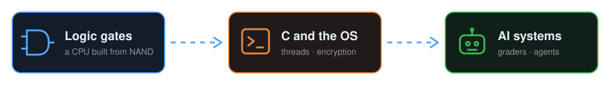
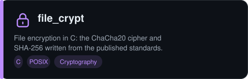
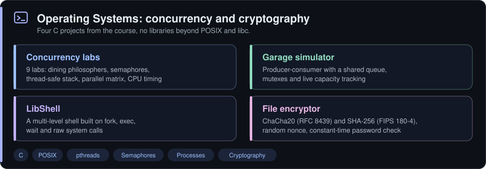
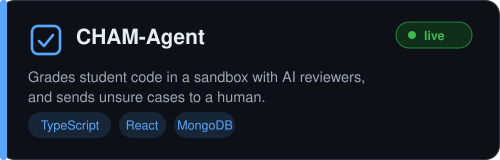
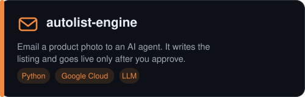
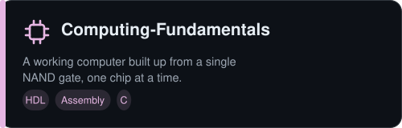
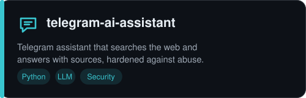

&nbsp;&nbsp;&nbsp;
&nbsp;&nbsp;&nbsp;

I build software that has to be correct: low-level C that talks directly to the operating system, and AI systems that are checked, sandboxed and safe to put in front of real users.
I also teach C in a Ministry of Defense cyber program, so explaining hard things clearly is part of my daily work.

## Projects

<a href="https://github.com/Oratias07/os-concurrency-cryptography"><picture>
<source media="(max-width: 600px)" srcset="assets/os-systems-m.svg">

</picture></a>

<b>More projects</b> (click to expand)

- [data-mining-and-ML-course](https://github.com/Oratias07/data-mining-and-ML-course): labs on clustering, classification and evaluation
- [C-portfolio](https://github.com/Oratias07/C-portfolio): data structures in C
- [java-oop-exercises](https://github.com/Oratias07/java-oop-exercises): object-oriented design in Java

<b>Tech skills</b> (click to expand)

| | |
|---|---|
| **Languages** | C · C++ · Python · TypeScript · Java · Assembly · HDL |
| **Systems** | Processes and threads · memory management · Linux · CPU architecture |
| **AI** | LLM integration · RAG · prompt engineering · prompt-injection defense |
| **Backend and cloud** | MongoDB · Google Cloud · Docker · GitHub Actions |
| **Security** | RBAC · OAuth 2.0 · sandboxed execution · rate limiting |

## Experience

- 🧑‍🏫 **C Programming Instructor**, Cyber Education Program, Ministry of Defense · 2025 to now
- 📚 **Systems Programming TA**, Braude College of Engineering · 2025 to now
- 🔬 **AI in CS-education research**, Braude College of Engineering · 2026
- 🤝 **Crisis companion (volunteer)**, Ma'ana · 2024 to now

B.Sc. Software Engineering, Braude College of Engineering · GPA 85
