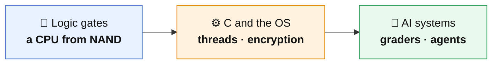

# Or Atias

**Software Engineering student · Systems programming · AI engineering · Security**

I build software that has to be correct: low-level C that talks directly to the operating system, and AI systems that are checked, sandboxed and safe to put in front of real users.
I also teach C in a Ministry of Defense cyber program, so explaining hard things clearly is part of my daily work.

## From a single gate to AI agents

## Projects

| | Project | In one sentence |
|:-:|---|---|
| 🎓 | [**CHAM-Agent**](https://github.com/Oratias07/CHAM-Agent) · [live](https://stsystem.vercel.app) | Grades student code in a sandbox with AI reviewers, and sends unsure cases to a human. |
| 🛍️ | [**autolist-engine**](https://github.com/Oratias07/autolist-engine) | Email a product photo to an AI agent; it writes the listing and goes live only after you approve. |
| 🔎 | [**job-agent**](https://github.com/Oratias07/job-agent) | Finds new student jobs every day and writes a tailored CV and cover letter for each. |
| 🔐 | [**file_crypt**](https://github.com/Oratias07/os-concurrency-cryptography) | File encryption in C, with the ChaCha20 cipher and SHA-256 written from the standards. |
| 🧠 | [**Computing-Fundamentals**](https://github.com/Oratias07/Computing-Fundamentals) | A working computer built up from a single NAND gate. |
| 💬 | [**telegram-ai-assistant**](https://github.com/Oratias07/telegram-ai-assistant) | Telegram assistant that searches the web and answers with sources, hardened against abuse. |

<b>More projects</b> (click to expand)

- [AI-workflow](https://github.com/Oratias07/AI-workflow): the prompts and principles I use to work with AI critically
- [data-mining-and-ML-course](https://github.com/Oratias07/data-mining-and-ML-course): labs on clustering, classification and evaluation
- [C-portfolio](https://github.com/Oratias07/C-portfolio): data structures in C
- [java-oop-exercises](https://github.com/Oratias07/java-oop-exercises): object-oriented design in Java
- [telegramBot](https://github.com/Oratias07/telegramBot): writes Hebrew LinkedIn posts
- [Learning-Center-by-Gemini](https://github.com/Oratias07/Learning-Center-by-Gemini): study assistant that answers from uploaded notes

<b>Tech skills</b> (click to expand)

| | |
|---|---|
| **Languages** | C · C++ · Python · TypeScript · Java · Assembly · HDL |
| **Systems** | Processes and threads · memory management · Linux · CPU architecture |
| **AI** | LLM integration · RAG · prompt engineering · prompt-injection defense |
| **Backend and cloud** | Node.js · REST · MongoDB · Google Cloud · Docker · GitHub Actions |
| **Security** | RBAC · OAuth 2.0 · sandboxed execution · rate limiting |

## Experience

- 🧑‍🏫 **C Programming Instructor**, Cyber Education Program, Ministry of Defense · 2025 to now
- 📚 **Systems Programming TA**, Braude College of Engineering · 2025 to now
- 🔬 **AI in CS-education research**, Braude College of Engineering · 2026
- 🤝 **Crisis companion (volunteer)**, Ma'ana · 2024 to now

B.Sc. Software Engineering, Braude College of Engineering · GPA 85
